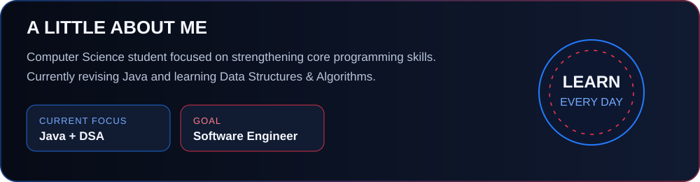

Anshul 👋

Java Developer in Progress | DSA Learner

Learning, building, and improving every day.

""GitHub" (https://img.shields.io/badge/GitHub-nxverxe-181717?style=for-the-badge&logo=github)" (https://github.com/nxverxe)

---

About Me

- 🎓 Computer Science student from Indore, India.
- ☕ Learning Java and Data Structures & Algorithms.
- 🌱 Exploring software development.

Tech Stack

"Java" (https://img.shields.io/badge/Java-ED8B00?style=for-the-badge&logo=openjdk&logoColor=white)
"Python" (https://img.shields.io/badge/Python-3776AB?style=for-the-badge&logo=python&logoColor=white)
"GitHub" (https://img.shields.io/badge/GitHub-181717?style=for-the-badge&logo=github)

GitHub Stats

"GitHub Stats" (https://github-readme-stats.vercel.app/api?username=nxverxe&show_icons=true&theme=tokyonight)

Connect With Me

"Instagram" (https://instagram.com/nxverxe) · "YouTube" (https://youtube.com/@nxverxe) · "CodePen" (https://codepen.io/nxverxe)
<!-- HERO -->Hey, I'm Anshul 👋

Java Developer in Progress | DSA Learner | Tech Enthusiast

Building my skills one line of code at a time.

""GitHub" (https://img.shields.io/badge/GitHub-nxverxe-070b16?style=for-the-badge&logo=github)" (https://github.com/nxverxe)
""Instagram" (https://img.shields.io/badge/Instagram-Follow-ff354f?style=for-the-badge&logo=instagram&logoColor=white)" (https://instagram.com/nxverxe)
""YouTube" (https://img.shields.io/badge/YouTube-Subscribe-ff354f?style=for-the-badge&logo=youtube&logoColor=white)" (https://youtube.com/@nxverxe)

---

 About Me

- 🎓 Computer Science student from Indore, India.
- ☕ Learning Java and Data Structures & Algorithms.
- 🧠 Improving problem-solving and programming fundamentals.
- 🌱 Exploring web development and software engineering.
- 🎯 Working toward becoming a skilled software developer.
- ⚡ Believe in consistency, practice, and learning by building.

 ---

🛠️ Tech Stack

"Java" (https://img.shields.io/badge/Java-ED8B00?style=for-the-badge&logo=openjdk&logoColor=white)
"Python" (https://img.shields.io/badge/Python-3776AB?style=for-the-badge&logo=python&logoColor=white)
"HTML5" (https://img.shields.io/badge/HTML5-E34F26?style=for-the-badge&logo=html5&logoColor=white)
"CSS3" (https://img.shields.io/badge/CSS3-1572B6?style=for-the-badge&logo=css3&logoColor=white)
"Git" (https://img.shields.io/badge/Git-F05032?style=for-the-badge&logo=git&logoColor=white)
"GitHub" (https://img.shields.io/badge/GitHub-181717?style=for-the-badge&logo=github&logoColor=white)

---

📊 GitHub Stats

---

🏆 Achievements

---

🌐 Let's Connect

""Instagram" (https://img.shields.io/badge/Instagram-ff354f?style=for-the-badge&logo=instagram&logoColor=white)" (https://instagram.com/nxverxe)
""Pinterest" (https://img.shields.io/badge/Pinterest-bd081c?style=for-the-badge&logo=pinterest&logoColor=white)" (https://pinterest.com/nxverxe)
""Reddit" (https://img.shields.io/badge/Reddit-ff4500?style=for-the-badge&logo=reddit&logoColor=white)" (https://reddit.com/user/u/Prize_Supermarket412)
""Twitch" (https://img.shields.io/badge/Twitch-9146ff?style=for-the-badge&logo=twitch&logoColor=white)" (https://twitch.tv/nxverxe)
""X" (https://img.shields.io/badge/X-000000?style=for-the-badge&logo=x&logoColor=white)" (https://x.com/WOSTL2234S)
""CodePen" (https://img.shields.io/badge/CodePen-ffffff?style=for-the-badge&logo=codepen&logoColor=black)" (https://codepen.io/nxverxe)

📧 Email: anshulgujar65@gmail.com

---

💙 Thanks for visiting my profile!

Keep learning. Keep building. Keep growing.

<!-- Profile README for nxverxe — dark navy / electric blue / crimson theme -->

  

  

  

  

## 👋 About Me

Hi, I'm **Anshul Sankdiya**, a B.Tech Computer Science student from Indore, Madhya Pradesh. I'm currently revising **Java** and learning **Data Structures & Algorithms** as I work toward becoming a software engineer.

- 🎓 B.Tech CSE student at Chameli Devi Group of Institutions
- 💻 Current focus: Java and DSA
- 🧠 Interested in software development and problem solving
- 🌱 Learning step by step and improving through practice

## 🧰 Current Focus

- Java fundamentals and object-oriented programming
- Data Structures & Algorithms
- Consistent problem-solving practice

> I’m still learning, so this profile will grow as I build projects and develop new skills.

## 🤝 Connect With Me

  

- **GitHub:** [@nxverxe](https://github.com/nxverxe)
- **LinkedIn:** Add your exact LinkedIn URL here

---

BUILD • LEARN • REPEAT

